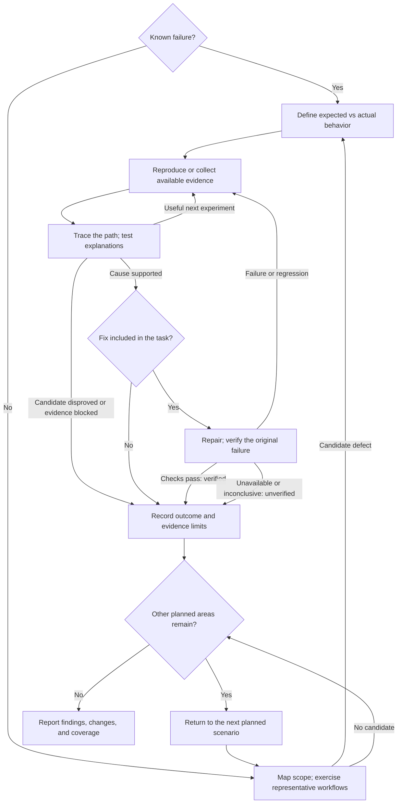

# Josh’s Skills

Reusable skills for bug investigation and evidence-backed research, with local references for use by humans and LLMs.

## Skills

| Skill | Purpose |
| --- | --- |
| [Diagnosing Bugs](skills/diagnosing-bugs/SKILL.md) | Diagnose reported failures and carry requested repairs through verification. |
| [Finding Bugs](skills/finding-bugs/SKILL.md) | Discover correctness defects through source inspection and representative workflow use. |
| [Heavy-Duty Research](skills/heavy-duty-research/SKILL.md) | Detailed research workflow with source evaluation, synthesis, and a pack of research-method references. |
| [Heavy-Duty Research Lean](skills/heavy-duty-research-lean/SKILL.md) | A more compact research workflow with conditional loading of a consolidated methodology checklist. |

Each folder is installable on its own. The research variants are alternatives; choose the one that fits how much methodology guidance you want loaded.

## Bug playbook

Checklists and a decision flow for humans and LLMs to find, explain, and fix software bugs. Each checklist says what to do, what evidence to keep, and which step comes next.

| Checklist | Use it when |
| --- | --- |
| [Diagnose and fix a bug](skills/diagnosing-bugs/references/checklist.md) | Something is broken, wrong, throwing, or slower than expected. |
| [Find bugs in a codebase or workflow](skills/finding-bugs/references/checklist.md) | You want to discover defects that have not been reported. |
| [Reproduce a frontend bug and locate the data mismatch](skills/diagnosing-bugs/references/frontend-boundary.md) | The UI is wrong and you need to distinguish request, backend-data, and client-handling problems. |
| [Trace a regression through versions and Git history](skills/diagnosing-bugs/references/regression-history.md) | Something used to work and you want to narrow when and how it changed, including with Git bisect. |

Start at the first unanswered question. Check boxes against actual evidence; mark inapplicable or blocked items explicitly. A small bug may need one experiment. A broader hunt needs a coverage record so finding one bug does not silently end the rest of the work.

To discover unknown bugs, exercise representative workflows in scope even when source inspection finds no candidate. Observe the changed outcome and the surrounding behavior users or consumers depend on; record a coverage gap if that workflow was not exercised. Validating a suspected defect comes after discovery, whether the lead arose from source, tests, or actual use.

Prefer reproducing a failure through actual use first: the affected UI, CLI, or API workflow in a representative environment, manually or through automation. If unavailable or a reasonable attempt does not reproduce it, use a faithful test against the real implementation as the fallback. Record **actual use**, **test only**, or **not yet reproduced** separately from each check's PASS/FAIL/UNRESOLVED result. Verify a repair against the reproduction and retry the actual workflow when available; test-only evidence does not establish end-to-end verification.

## Work from quick checks to expensive investigations

Both checklists use this default order. Choose checks that can answer the current question; the list is not a quota to finish.

| Effort | Diagnosing a known failure | Finding unknown bugs |
| --- | --- | --- |
| Quick | Confirm basics, try the reported steps, inspect existing errors/data | Define scope, exercise representative workflows, inspect available evidence |
| Focused | Trace the mismatch, inspect a relevant diff, test an explanation | Challenge candidates with concrete boundary or sequence checks |
| More involved | Add targeted probes or a faithful harness; compare code/context | Exercise integration, failure recovery, or stateful behavior where needed |
| Expensive | Reconstruct environments, run prolonged trials, rebuild historical versions or bisect | Run justified extended stress/property searches or version/configuration comparisons |

Stop escalating when the evidence supports the next decision. A requested fix still needs verification, and an exhaustive hunt still needs its remaining coverage even when that work is expensive. The history checklist starts with inexpensive version facts and diffs; bisect is a later branch.

## Decision flow



The detailed checklists distinguish a failed check from a setup failure, a supported diagnosis from a hypothesis, and a verified repair from a workaround. During an incident, authorized mitigation can come first; preserve evidence and resume diagnosis afterward. When no useful next check is possible, record the blocker and continue independent work within scope.

## Use with a human or an LLM

Copy the relevant checklist into your issue or working notes. A short instruction is enough:

> Follow the linked checklist for this task. Record evidence beside completed steps and explain any blocked or inapplicable items. Continue through the requested scope, including repair and verification when asked.

The bug checklists are the method. Their installable skills are small adapters that load those same documents for a coding agent.

Each skill folder includes a `SKILL.md` and its local references. The bug skills also include agent metadata, and Diagnosing Bugs includes an optional human-assisted reproduction template.

## Install in Codex

Clone the public repository on another machine:

```sh
git clone https://github.com/joshwoods/josh-skills.git
cd josh-skills
```

Copy the skill folders you want into your Codex skills directory. Back up any existing copies before replacing them. To install all four:

```sh
skill_destination="${CODEX_HOME:-$HOME/.codex}/skills"
mkdir -p "$skill_destination"
cp -R skills/diagnosing-bugs skills/finding-bugs skills/heavy-duty-research skills/heavy-duty-research-lean "$skill_destination/"
```

In a new session, invoke the skill by name. For example:

- “Use $diagnosing-bugs to investigate and fix this crash: …”
- “Use $finding-bugs to review the import workflow for correctness defects.”
- “Use $heavy-duty-research to investigate this question and produce an evidence-backed brief: …”
- “Use $heavy-duty-research-lean to compare these options, including source quality and uncertainties: …”

## Use with other agents

Copy the complete folders into the agent’s supported skill location, or provide the relevant `SKILL.md` and its linked references as task context. If installing both bug skills, keep them as siblings so their optional cross-references work. Adapt installation to the receiving tool; the methods do not require a particular model.

## Sources and validation

Research sources and limitations are recorded in [diagnosis sources](skills/diagnosing-bugs/references/sources.md) and [discovery provenance](skills/finding-bugs/references/provenance.md).

The bug instructions were revised using OpenAI’s [GPT-6 Astra skill guidance](https://developers.openai.com/blog/rethinking-skills-and-prompts-for-gpt-6-astra). Format checks and editorial review do not establish improved task performance; effectiveness requires evaluation on representative tasks.
